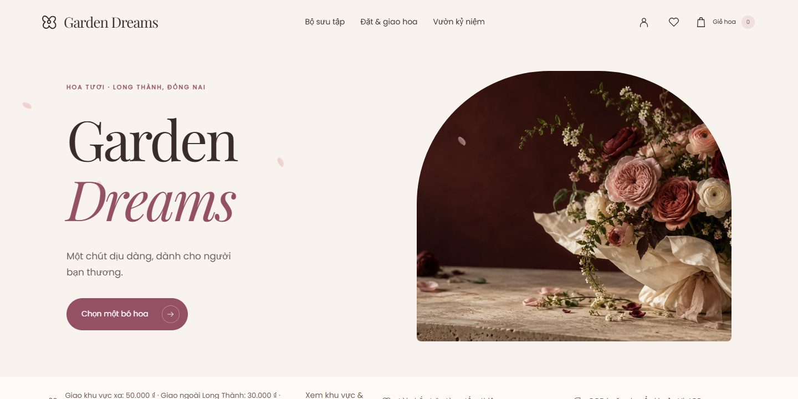
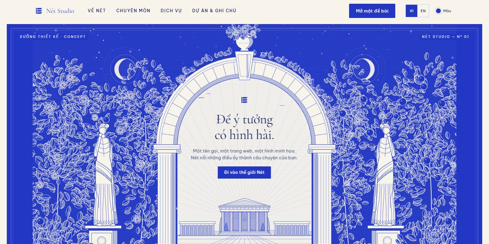

<picture>
  <source media="(max-width: 600px)" srcset="./assets/profile-header-mobile.svg?v=readable" />
  
</picture>

# Fullstack developer. UI & motion.

I'm **Astraa**, based in Vietnam. I build expressive interfaces and the components, APIs and systems behind them.

**[Explore my portfolio](https://astraa1.vercel.app)** &nbsp; · &nbsp; **[Get in touch](mailto:lagna0175@gmail.com)**

[Selected&nbsp;work](#selected-work) &nbsp; / &nbsp; [Interface&nbsp;lab](#interface-lab) &nbsp; / &nbsp; [Behind&nbsp;the&nbsp;interface](#behind-the-interface)

## Selected work

### ProZ0
**Current focus · Browser game**

A pixel-art survival sandbox about rebuilding civilization and exploring the traces of an older one. Colony depth and industry are in development.

TypeScript / PixiJS / Vite

[Open browser build](https://proz0-colony.vercel.app) &nbsp; · &nbsp; [Source](https://github.com/5erax/ProZ0) &nbsp; · &nbsp; [Development board](https://github.com/users/5erax/projects/4/views/1)

### Garden Dreams
**Commerce · Interactive storefront**

A Vietnamese florist storefront with motion, product discovery, a cart and customer order flows.

React / Motion / Supabase

[View website](https://garden-dreams-florist.vercel.app) &nbsp; · &nbsp; [Source](https://github.com/5erax/garden-dreams-florist)

### MediMate AI
**Healthcare · Web & mobile**

An AI-assisted pre-visit interface for symptom intake, care discovery, lab-test information and patient workflows, with a mobile companion.

React / Vite / MapLibre

[View web app](https://sep-490-fe-medical-ai-assistant.vercel.app) &nbsp; · &nbsp; [Web source](https://github.com/5erax/SEP490_FE_MedicalAIAssistant) &nbsp; · &nbsp; [Mobile source](https://github.com/5erax/SEP490_MB_MedicalAIAssistant)

### Recent builds

**[NexusERP](https://github.com/5erax/nexuserp)**  
A multi-branch ERP using Next.js, NestJS and PostgreSQL. IAM is implemented; catalog and inventory work is in progress. [Roadmap](https://github.com/users/5erax/projects/5)

**[NewLife](https://github.com/5erax/newlife-web)**  
A Vietnamese life simulation with branching choices and local saves. Playable offline after its first full load. [Play](https://newlife-web-gray.vercel.app)

**[Nét Studio](https://github.com/5erax/net-studio)**  
A bilingual studio website with engraved illustrations and choreographed motion, built with React, GSAP and Lenis. [View website](https://net-studio-nu.vercel.app)

<strong>View recent project previews</strong>

 

**NexusERP**

**NewLife**

**Nét Studio**

<strong>More projects</strong>

 

- **[FinGenie](https://github.com/5erax/FinGenie)**: AI-assisted personal finance across web and mobile.
- **[GeoConnect](https://github.com/5erax/geoconnect)**: maps, location-based communities and real-time messaging.
- **[CVmate](https://github.com/5erax/CVmate)**: CV creation, ATS-oriented feedback and interview practice.
- **[Ecommerce Mobile](https://github.com/5erax/ecomerce-mobile)**: a shopping experience with React Native and Expo.
- **[MLN Web](https://github.com/5erax/MLN-web)**: interactive lessons, timelines and quizzes.

[Browse all repositories](https://github.com/5erax?tab=repositories)

## Interface lab

<picture>
  <source media="(max-width: 600px)" srcset="./assets/interface-lab-mobile.svg?v=readable" />
  
</picture>

**Hierarchy, feedback and continuity.** I use type to guide attention, interaction to acknowledge actions, and motion to explain changes of state.

<strong>Explore my portfolio experiences</strong>

 

- **[Scroll journal](https://astraa1.vercel.app)**: paper tears, flipping postcards and a scroll-driven project story. [Source](https://github.com/5erax/astraa-scroll-portfolio)
- **[Desktop portfolio](https://astraa-pf.vercel.app)**: windows, folders, Spotlight and a pastel dock. [Source](https://github.com/5erax/personal-portfolio)
- **[Interfaces in motion](https://github.com/5erax/Pflio)**: a cinematic WebGL portfolio with shader atmosphere and a shared scroll timeline.

Cover art and motion studies are SVG. Website previews are live-site captures. See the repositories for template credits.

## Behind the interface

I build the visual layer and the structure behind it, from reusable components to persistence and business rules.

**UI & motion**  
React, Next.js, TypeScript, Figma, GSAP, Motion, PixiJS

**Mobile**  
React Native, Expo

**Backend & data**  
Node.js, NestJS, Spring Boot, PostgreSQL, Supabase, Prisma

**Delivery**  
Git, Docker, GitHub Actions

  
<strong>My journey</strong>

 

| When | Focus |
| :--- | :--- |
| **2024 - present** | **Fullstack development.** Web and mobile applications, with particular care for UI and interaction. |
| **2023** | **Frontend internship.** Responsive layouts, reusable components, and interface consistency. |
| **2020 - 2024** | **Computer science studies.** Programming, databases, algorithms, and software development fundamentals. |

  
<strong>GitHub activity</strong>

 

[View my GitHub activity →](https://github.com/5erax?tab=overview)

  
<strong>Off the keyboard</strong> - recently played

 

  

[Find me on Spotify →](https://open.spotify.com/user/317a5piogpvphdsatuu2a4b42dgm)

## Let's build something that feels right.

Open to frontend and fullstack opportunities where **UI and interaction matter**.

[lagna0175@gmail.com](mailto:lagna0175@gmail.com)
